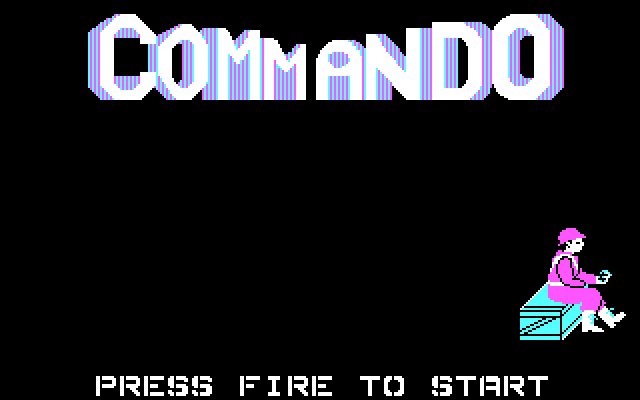
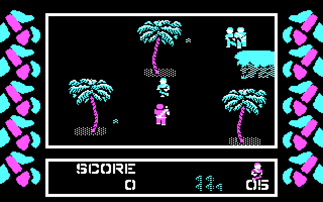
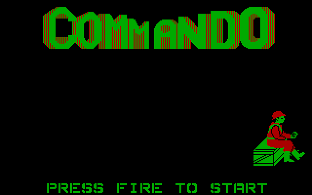
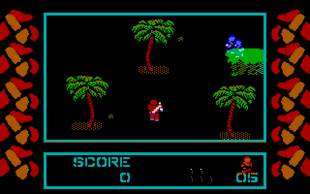
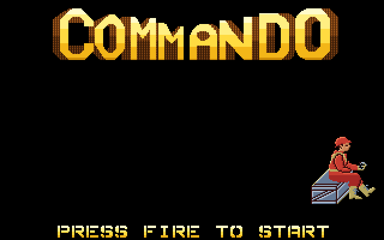
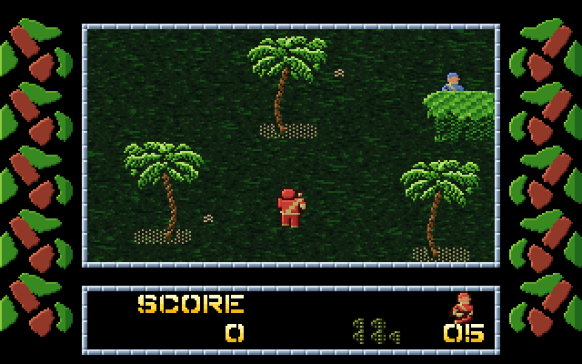
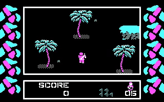
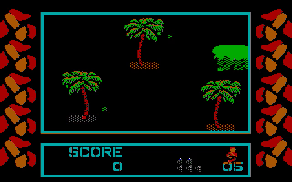
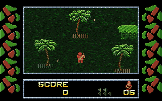

# Commando VGA – experimental 320×200 256-colour conversion

An offline graphics conversion of the 1987 DOS release of *Commando* (Data East / Capcom licence, Quicksilver Software port) from CGA mode 4
to VGA mode 13h. The original game engine, movement, collision detection, timing, sprite positions, animation and controls are meant to stay
untouched; only the graphics layer is replaced by VGA routines that draw pre-converted 256-colour artwork. **No AI analysis or CGA→VGA
conversion happens while the game runs** – everything is generated offline and stored as ordinary files.

**By Dag Erik Hagesæter / Retro Erik using Claude Sonnet 5.5 in VS Code** · [YouTube: Retro Erik](https://www.youtube.com/@RetroErik)


## Overview

| Item | Details |
|---|---|
| Target | MS-DOS, 8086/8088-compatible code, VGA mode 13h (320×200, 256 colours) |
| Source | Commando 1.01 (1987-02-25) – `Original game files/COMMANDO.EXE`, `COMMANDO.DAT`, `START.COM` (never modified; not in the repository) |
| Approach | same game logic → replacement VGA graphics primitives → pre-converted artwork with identical sizes, transparency, frame counts and positions |
| Status | **v1.0 (artwork), v1.1 (+AdLib) and v1.2 (+CMS) built** in `VGA/releases/`; title, high scores and demo/gameplay for levels 1–3 verified in DOSBox/emulator. Name entry, explosions/bullets/vehicles and a real-hardware speed check still need a play-through. |
| Not related to | the Plantronics ColorPlus patch (`Codex/Plantronics`); it was studied for knowledge only |

## The story: from the PC speaker to 256 colours

This project is the fourth step in a series of experiments on the same 1987 DOS port of *Commando*, all by Dag Erik Hagesæter / Retro Erik using AI coding assistants in VS Code. The original game is a 4-colour CGA game with PC-speaker sound.

1. **AdLib sound with Copilot** – [`Copilot`](Copilot/README.md). A DOS add-on that plays *Commando's own melody* through an AdLib/OPL2 card, and gives the gun a short noise-based FM sound. It does not copy the song data: it follows the game's own sequencer and converts the pitches it resolves into OPL notes.
2. **CMS music with Codex** – [`Codex`](Codex/README.md). A Game Blaster/CMS (two SAA1099 chips) add-on. It converts Rob Hubbard's C64 *Commando* tune offline into a compact eight-minute CMS score, plays it from the game's timer, keeps the game's own effects, and lets the game's `M` key mute and restore the music.
3. **Plantronics ColorPlus colour with Codex** – [`Codex/Plantronics`](Codex/Plantronics/README.md). An experiment to give the game 16 colours on the rare Plantronics ColorPlus card (320 × 200 × 16, tested in 86Box). The patch keeps the game's drawing code and adds a second 16 KB video bank at `BC00:0000` that holds two more colour bits per pixel. The game's own CGA drawing fills the lower bank; recoloured copies of the sprites and some lookup tables fill the upper bank, and a resident loader copies both banks to the screen together. The hero became red, the enemies blue, the frames dark cyan.
4. **VGA 256 colours (this project)** – an entirely different approach, described below. It then received the AdLib and CMS music from steps 1 and 2.

### Why the Plantronics patch is not a very good solution

- **Colour by rule, not by artwork.** The sprites still contain only the original 2-bit shapes. Colours are assigned by rules (this block of sprites is red, that block is blue), so shading, highlights, texture and real pixel art are not possible, and some details (for example the life marks) stayed too dark.
- **Only 16 colours** on hardware that very few people own; DOSBox cannot show it at all, so it needs 86Box or a real card.
- **A heavy bank/shadow system.** Everything must be drawn twice and kept in sync: RAM shadows of both banks, restoring the old sprite footprint in the extra bank, and paired transfers of every changed word. This costs speed: it felt slow at 10 MHz and the 86Box tests moved to 16 MHz.
- **A large resident loader** (55 KB) that hooks the game through a series of interrupts, and patches that have to be repeated for the game file and its copy inside `COMMANDO.DAT`.

### The pivot: a different architecture for VGA

Instead of recolouring CGA data while the game runs, the VGA version replaces the *graphics layer* and leaves the game logic alone:

```text
Plantronics:  game logic -> CGA drawing routines -> CGA bank  + shadow-recoloured upper bank -> paired copy
VGA:          same game logic -> VGA drawing routines -> pre-converted 256-colour artwork -> mode 13h
```

All artwork was extracted and redrawn **offline** with a 256-colour palette, at exactly the original sizes, transparency and frame counts, and was approved image by image before it entered the game. Nothing is analysed or converted while the game runs. The VGA routines look the artwork up by the original sprite address, so the game's headers, collision rectangles and timing stay untouched. The Plantronics project was studied for its knowledge of the game (sprite formats, drawing routines, game states), but its bank and shadow design was not reused.

The last step brought the sound work back in: the **AdLib** engine (idea from the Copilot add-on) and the **CMS** player and Hubbard score (from the Codex add-on) were rewritten as part of the VGA build, and the `M` key now cycles *speaker → CMS → AdLib → off*.

### The three versions side by side

Frames from the real game code, each running headless in the project's 8086 emulator (`tools\make_readme_screens.py`): the original, the Plantronics build (its loader and both video banks decoded to 16 colours) and the VGA build. They are emulator renders, not photographs of hardware.

| | Title screen | Gameplay |
|---|---|---|
| **Original CGA** – 4 colours |  |  |
| **Plantronics ColorPlus** – 16 colours |  |  |
| **VGA mode 13h** – 256 colours (this project) |  |  |

### Ten seconds of gameplay

The same ten seconds of the game's self-playing demo in each version. The animated previews below are silent GIFs; **click the link under each one for the MP4 with sound**.

| Version | Preview (silent) | Video with sound |
|---|---|---|
| **Original CGA** – 4 colours, PC speaker |  | [commando_cga_pc_speaker.mp4](VGA/docs/video/commando_cga_pc_speaker.mp4) |
| **Plantronics ColorPlus** – 16 colours, PC speaker |  | [commando_plantronics.mp4](VGA/docs/video/commando_plantronics.mp4) |
| **VGA** – 256 colours, **CMS** (Game Blaster) music |  | [commando_vga_cms.mp4](VGA/docs/video/commando_vga_cms.mp4) |
| **VGA** – 256 colours, **AdLib** music |  | [commando_vga_adlib.mp4](VGA/docs/video/commando_vga_adlib.mp4) |

How they were made: the CGA and both VGA clips are real DOSBox 0.74-3 recordings (picture and sound together, 4000 cycles/ms, which gives about 20 game frames per second), with the sound device chosen through the M key.
DOSBox cannot show ColorPlus colours, so the **Plantronics picture is rendered by the project's 8086 emulator** from the real Plantronics build (one frame per screen update, played at the same 20 frames/s), while its **sound is recorded from the same Plantronics build in DOSBox**; picture and sound
of that clip are therefore not frame-synchronised. The CMS and AdLib clips look identical; they differ in sound only. The title screen is left out on purpose.

## Features (so far)

- Complete description of the CGA graphics system, sprite format, fonts, tiles, title bitmaps, scenery layers and the level data stored in `COMMANDO.DAT` – see [VGA/docs/ANALYSIS.md](VGA/docs/ANALYSIS.md).
- Evidence that **collision/gameplay logic never reads sprite pixels or masks** (only sprite headers), but does read a separate **scenery attribute layer** that must be preserved.
- 90 sprite records, 76 large-font glyphs, 10 frame tiles, 5 title bitmaps and 61 distinct scenery bitmaps (3 levels) extracted, catalogued and redrawn in 256 colours.
- Releases v1.0 (VGA artwork), v1.1 (+AdLib) and v1.2 (+CMS) with an M-key device cycle.
- An offline 8086 emulator that runs the real game headless (title → gameplay → high scores, levels 1–3) for tracing and, later, regression tests.
- A proposed 256-colour palette built from named, contiguous colour ramps and rule-based, pixel-for-pixel recolouring of every graphic.

## Quick Start

### Play (no build needed)

1. Download [Commando.zip](Commando.zip) and unzip it to a folder.
2. On a VGA PC or in DOSBox run `START.COM` (`START /?` shows the help screen).
3. Press **M** to cycle the music device: speaker → CMS → AdLib → off.

DOSBox example: `mount c <folder>`, `c:`, `START.COM` (use `machine=vgaonly`, and `sbtype=gb` for CMS or `sbtype=sb16` for AdLib).

### Known limitations

- Gameplay equality with the original is **not proven** beyond the title screen and the collision layer (see Verification); play-test reports are welcome.
- Not yet play-tested: name entry, explosions/bullets, vehicles, real-hardware speed and CMS/AdLib sound on real hardware.
- Every frame copies 64,000 bytes to VGA memory, so a 286 or faster PC is advisable.
- CMS cannot be detected by software, so it is always offered in the M cycle.

### Build from source

You need your own copy of the original `COMMANDO.EXE`, `COMMANDO.DAT`, `START.COM` and `STARTC.COM` in the folder `Original game files` next to the `VGA` folder; they are not part of this repository (the folder is excluded by `.gitignore`).
All commands below are run from the `VGA` folder.

### Requirements

- Python 3.10+ with Pillow (`pip install pillow`).
- GNU binutils (`as`, `ld`, `nm`, `objcopy`, `objdump`) for 32-bit PE/i8086 – the tools default to Free Pascal 3.2.2 (`C:\FPC\3.2.2\bin\i386-win32`); set `COMMANDO_BINUTILS` to another folder to override it.
- DOSBox 0.74-3 for screenshot automation and VGA tests – the default path is `C:\Program Files (x86)\DOSBox-0.74-3\DOSBox.exe`; set `DOSBOX_EXE` to override it.

### Rebuild the evidence, atlases and previews

```text
python tools\disasm.py
python tools\catalog_sprites.py
python tools\atlas_orig.py
python tools\atlas_fonts_menu.py
python tools\extract_scenery.py
python tools\extract_misc.py
python tools\make_previews.py
```

Run the emulator (about 1 M instructions per second):

```text
python tools\emu_script.py test\emu "4000000:key:3920,5000000:snap:gameplay"
python tools\test_sprite_independence.py 1 6000000
```

Take DOSBox screenshots of the original game:

```text
.\tools\dosbox_shot.ps1 -Dir "$PWD\test\orig" -Run "START.COM" -Out "$PWD\test\shots" -Steps @(@{At=5;Shot=$true}) -Total 8
```

## Build and run the VGA version

```text
python tools\build_vga.py
```

This assembles `src/vga.s` (GNU `as`, 8086 instructions only), packs the approved artwork (`tools/vga_assets.py`) and writes a **patched copy** of the game to `build/`
(`COMMANDO.EXE` plus unmodified copies of `COMMANDO.DAT`, `START.COM`, `STARTC.COM`). The originals are only read and are hash-checked. Run it in DOSBox (VGA machine) or on a VGA PC:

```text
cd build
START.COM
```

| Part | How it works |
|---|---|
| Patching | 12 CGA routines (RAM-screen fill, present, retrace wait, address calc, sprite draw/erase, glyphs, title bitmaps, dissolve, ground blit, foreground overlay, clear) get a 3-byte jump to the VGA replacement; 9 call sites (mode set, scenery/ground row builders) are redirected; 8 immediates changed (RAM screen 64 KB, `B800h`→`A000h`, text advance 3 bytes → 12 pixels). The full list is in `build/patch_log.txt`. |
| Layout | New code (CS:8360h, 16 KB reserved), the artwork (93 KB, paragraph aligned) and a 28 KB 8-bit ground ring are inserted between the code and data segments; DS, SS and the two DS relocations are corrected. The original data segment (all CGA sprite masks, collision layer, level loader) is untouched. |
| Sprites | The VGA bitmap is found through the original CGA record address, so the game's logic, headers, odd-x variants and collision rectangles are unchanged. |
| Ground | The scrolling ground is composed in 8 bits from the VGA scenery bitmaps while the original 2-bit scenery attribute (collision) layer is still built by the original code. Ground texture shades use a private LFSR, never the game's random numbers. |
| Timing | Mode 13h refreshes at ~70 Hz instead of ~60 Hz; the retrace wait inserts an extra wait on 17 % of calls to keep retrace-locked parts at the original speed. |
| Requirements | VGA with mode 13h. The present copies 64,000 bytes per frame, so a 286 or faster machine is advisable (an 8088 will be slow); dirty-rectangle presenting is a possible future optimisation. |

### Releases

**Download the playable v1.2:** [Commando.zip](Commando.zip) (`COMMANDO.EXE`, `COMMANDO.DAT`, `START.COM`) – unzip, then run `START.COM` on a VGA PC or in DOSBox.

| Version | Folder | Content |
|---|---|---|
| 1.0 | `VGA/releases/v1.0` | approved 256-colour artwork, PC-speaker sound (original) |
| 1.1 | `VGA/releases/v1.1` | v1.0 + **AdLib/OPL2 music and effects** (from `Copilot/README.md`) |
| 1.2 | `VGA/releases/v1.2` | v1.1 + **CMS / Game Blaster (SAA1099) music** (from `Codex/README.md`, SID mode 5; 114 KB score embedded) |

Each folder holds `COMMANDO.EXE`, `COMMANDO.DAT`, the launcher `START.COM` and a `README.md`. The launcher is built from `Original game files/STARTC2.COM` by `tools\make_launcher.py`
(banner "Adapted for VGA, CMS and Adlib by Retro Erik 2026 using Claude Sonnet 5.5" and the `/?` help screen, adapted to the version). Rebuild with
`python tools\build_vga.py 0|1` (1 = CMS) and `python tools\make_release.py 1.2` (which also writes `Commando.zip`).

**M key** cycles `SPEAKER -> CMS -> ADLIB -> OFF` (v1.1 has no CMS step), starting on speaker. The title menu row reads `(M) Music Device <name>` and a short label appears on screen.
AdLib is detected at start-up and skipped when absent; CMS cannot be detected and is always offered. Q silences every device before returning to DOS. In AdLib/CMS modes the speaker
ports are not written, and the game's own tune/effect logic (priorities, timing) still drives the sound, so sound effects stay in sync with the action.
Sources: `src/snd.s` (dispatcher, OPL engine, M key), `src/cms.s` (SAA1099 player).

### Verification

Verified:
- Original files hash-identical before/after; collision/attribute layer `DS:CD60-DB5F` identical to the original in the emulator at title and at start of play.
- Earlier proof that gameplay never reads sprite pixels or masks (scrambling them changes nothing).
- DOSBox: all three releases start via their launcher, mode 13h renders, M cycles devices, label and `/?` help display, Q exits.
- AdLib: 21/21 melody notes match the game's own divisors (within 1 %); CMS: register stream equals an independent score model (2105 writes, 0 mismatches).

**Not proven:** byte-for-byte gameplay equality with the original. The emulator comparison (`tools\compare_builds.py`) is inconclusive: the two builds only reach a pre-game state, and the
VGA retrace padding (70 Hz to 60 Hz) deliberately changes the pacing seen in the emulator's virtual time, so the timer phase and random seed drift apart. An earlier claim that only 3 bytes differ
only covered the title screen and was overstated. Play-test needed: name entry, explosions/bullets, vehicles, real-hardware speed, CMS audio on real hardware.

Small deviations from the approved previews: the grenade-stock pile and its blank piece are brighter / pure black for readability on the panel, and the 12×5 pebbles are colour-keyed so the textured ground shows through.

## Review the proposed VGA artwork

Preview sheets are enlarged ×3–×6 **for inspection only**; the game assets keep the original pixel size.

| File | Content |
|---|---|
| [VGA/preview/playfield_mock_vga.png](VGA/preview/playfield_mock_vga.png) | composite mock-up of a level 1 screen with the proposed art (1:1 version: `playfield_mock_vga_1to1.png`) |
| [VGA/preview/palette_vga.png](VGA/preview/palette_vga.png) | the proposed 256-colour palette and its ramps |
| [VGA/preview/hero_vga.png](VGA/preview/hero_vga.png) | hero – 26 frames, original beside proposal |
| [VGA/preview/enemies_vga.png](VGA/preview/enemies_vga.png) | enemy soldiers – 27 frames |
| [VGA/preview/vehicles_objects_vga.png](VGA/preview/vehicles_objects_vga.png) | jeep, truck, motorbike, gun, crates, grenades, panel pieces, cursor, title hero |
| [VGA/preview/effects_vga.png](VGA/preview/effects_vga.png) | explosions, hits, bullets, bonus pop-ups |
| [VGA/preview/scenery_all_vga.png](VGA/preview/scenery_all_vga.png) | **all 61** scenery bitmaps of levels 1–3 (rocks, bushes, walls, gates, bunkers, towers ...) – the build uses these |
| [VGA/preview/scenery_vga.png](VGA/preview/scenery_vga.png) | first scenery proposal (palms, rock, ground fills) |
| [VGA/preview/ui_vga.png](VGA/preview/ui_vga.png) | fonts, frame tiles, title logo, side art |

Original-graphics atlases (in `VGA/atlas/`): `orig_*_cga.png`, `scenery_cga.png`, `scenery_collision_attr.png`, `font_*_cga.png`, `menu_title_cga.png`,
`raw_all_sprites_cga.png` (every sprite record found), `screens_original.png` (reference screens).

## Technical notes

- Mode 13h has the same 320×200 geometry as CGA mode 4; object X is stored in 2-pixel units, so one VGA bitmap per sprite serves both the even- and odd-x images.
- The VGA renderer will keep the original sprite headers in the data segment (width/height drive collision) and look the artwork up by original record address.
- The 28-byte-per-row scenery attribute layer in the level data is the gameplay-relevant scenery data and stays exactly as loaded.
- Details, addresses and the planned architecture: [VGA/docs/ANALYSIS.md](VGA/docs/ANALYSIS.md).

## Project layout

| Path | Purpose |
|---|---|
| `Commando.zip` | the playable VGA v1.2 release (`COMMANDO.EXE`, `COMMANDO.DAT`, `START.COM`) |
| `Original game files/` | **not in the repository** – your own copy of the original `COMMANDO.EXE`, `COMMANDO.DAT`, `START.COM`, `STARTC.COM` (plus the `STARTC2.COM` launcher and `Commando.sid` used by the add-on projects) |
| `Copilot/`, `Codex/`, `Codex/Plantronics/` | the earlier AdLib, CMS and Plantronics ColorPlus projects (each with its own README) |
| `VGA/` | this project; the paths below are relative to this folder |
| `VGA/docs/ANALYSIS.md` | graphics-system analysis and VGA design |
| `VGA/docs/images/` | README screenshots (original CGA, Plantronics, VGA), made by `tools\make_readme_screens.py` |
| `VGA/docs/video/` | 10-second clips (MP4 with sound, silent GIF previews) made by `tools\make_readme_videos.ps1` |
| `VGA/releases/` | v1.0, v1.1 and v1.2 release folders |
| `VGA/src/` | the VGA layer (`vga.s`), AdLib/dispatcher (`snd.s`) and CMS player (`cms.s`) |
| `VGA/tools/` | emulator, tracers, extractors, art generator, DOSBox helpers |
| `VGA/extracted/` | catalogs (`*.json`) and raw binaries of the original graphics, fonts, menu bitmaps and level data |
| `VGA/atlas/` | labelled atlases of the original CGA graphics and reference screens |
| `VGA/preview/` | proposed VGA artwork (approved and used by the builds) |
| `VGA/analysis/` | disassembly, traces and audit outputs |
| `VGA/test/` | DOSBox/emulator captures (`test/orig` = copy of the original files for DOSBox runs; not in the repository) |

## Testing

1. Emulator frames must match DOSBox screenshots of the original game (verified for gameplay: same layout, palms, panel, sprites).
2. `test_sprite_independence.py` must report `0 differing bytes`.
3. After a VGA build exists: variable-region equality with the original after N frames, then DOSBox smoke tests (mode 13h, palette, startup, no crash).

## Credits, license, contributing

- **Tools, analysis, VGA artwork, VGA/AdLib/CMS patches:** **By Dag Erik Hagesæter / Retro Erik using Claude Sonnet 5.5 in VS Code** · [YouTube: Retro Erik](https://www.youtube.com/@RetroErik).
- **AdLib music engine ideas:** the Copilot AdLib project ([Copilot/README.md](Copilot/README.md)). **CMS player and score:** the Codex CMS project ([Codex/README.md](Codex/README.md)), arrangement of Rob Hubbard's *Commando* tune (Elite).
- **Original game:** *Commando* (Capcom / Data East licence, Quicksilver port, 1987); the original crack launcher is by Demonlord (1999). None of this is licensed by this project.
- **License:** the tools, source, documentation and redrawn artwork in `VGA/` are under the MIT license ([LICENSE](LICENSE)). The original game files, graphics and music are **not** covered and remain the property of their rights holders;
  the patched game files in `VGA/releases/` and `Commando.zip` are provided unofficially for preservation and retro-computing use only – use them only if you have the right to do so, and remove them on request of the rights holders.
- **Contributing:** bug reports and play-test findings (especially real-hardware speed, CMS/AdLib sound and gameplay regressions) are welcome via [Retro Erik on YouTube](https://www.youtube.com/@RetroErik) or GitHub issues.
